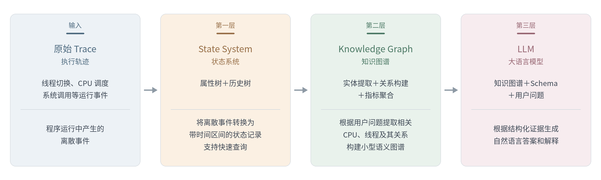
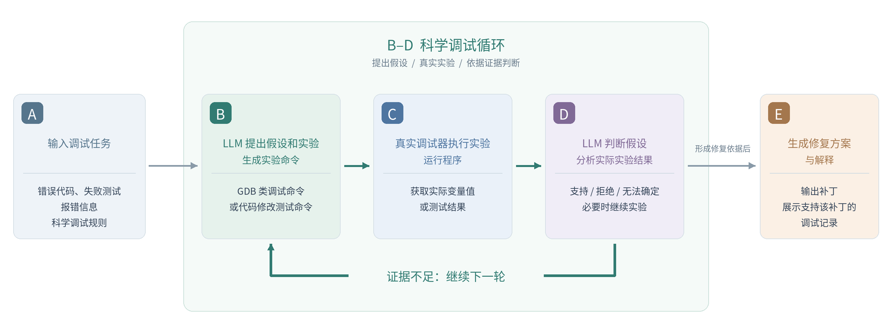
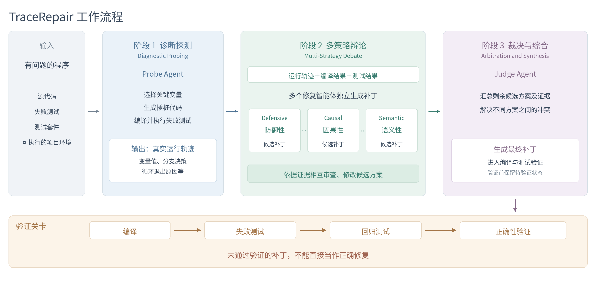
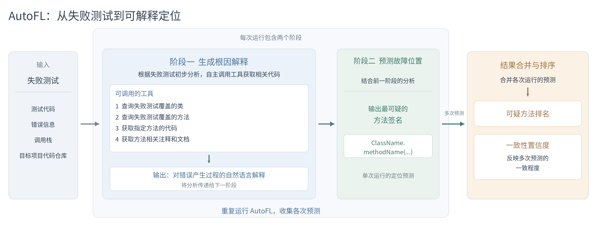

# 《TAAF：知识图谱与大语言模型协同的执行轨迹抽象和分析框架》
## 问题
如何利用知识图谱和LLM，让开发者更容易理解和分析已经采集到的程序运行数据？
## 核心思想
不把海量原始 Trace 直接交给 LLM，而是先整理成具有时间信息和实体关系的结构化数据，再由 LLM 根据用户问题进行分析
在操作系统和大型软件中，程序执行会产生大量 Trace（执行轨迹），记录线程调度、CPU 执行、文件操作、系统调用等事件。
目前已经有 LTTng、Trace Compass 等工具支持采集和查询这些信息，但依然存在三个问题：
1. 数据量大：短时间运行就可能产生数千万甚至数亿条事件，无法全部输入 LLM。
2. 事件关系复杂：一个分析问题可能涉及线程、CPU、文件以及多个时间区间，需要关联不同事件。
3. 分析门槛高：开发者通常需要掌握操作系统内部机制，并编写专门的查询脚本才能得到答案。
TAAF 就是希望开发者直接用自然语言提问，由系统完成结构化分析。
## TAAF 的整体架构

在第一层作者利用已有的State System，建立属性树和历史树把事件流转化为状态历史

第二层要做的是将状态转换为语义关系，知识图谱会把原本分散在时间状态中的实体、关系和数值组织成 LLM 更容易理解的证据结构

最终形成底层系统负责形成可信数据，上层 LLM 负责理解和解释的总体架构

# 《AutoSD：基于大语言模型驱动科学调试的可解释自动化调试》
## 问题
如何让 LLM 调试程序的同时，提供由执行结果支持、便于开发者理解和验证的修复解释？
传统的自动化程序修复已经能够自动生成补丁，可以告诉开发者应该怎么修改代码，却没有清楚地说明为什么这样修改，也就是应该提供能够帮助人类检查和理解补丁的解释。
## 方法
模拟人类的科学调试过程，让llm像程序员一样，通过“提出假设 → 运行实验 → 观察结果 → 得出结论”，完成可解释的自动化调试
## 实现

具体来说，AutoSD 有两个主要组成部分：
- LLM 负责决策： 分析代码、提出错误假设、生成实验、判断观察结果、提出修复方案。
- 真实调试器负责提供运行事实： 执行断点、检查变量、运行测试，并把实际结果返回给 LLM。
提出了一种基于真实运行实验、能够解释调试过程的自动化调试方法。
但是AutoSD需要反复调用 LLM 和调试器，生成补丁的平均耗时约为直接使用 LLM 的 4.66倍，其次，实验默认知道出现bug的解决方法，主要处理单方法范围内的 Bug，没有证明能够可靠处理大型跨模块错误。

未来方向：调试器负责提供专业的异步运行证据，LLM 利用这些证据主动提出和验证调试假设，可以研究的是 Rust async 特有的执行语义、验证约束与异步调试任务是否能带来新的方法

# 《REval：基于LLM的运行时行为推理》
## 问题
大语言模型能否真正理解程序运行时发生了什么，以及在连续推理过程中逻辑一致能否保持的问题
现有LLM对代码的评测往往重视输入和输出，但并不会充分检查程序执行中间发生的事情
作者把问题分成两个部分：
- 1： 大模型推理程序运行时行为的能力究竟如何？
- 2： 大模型在一系列逐步关联的推理任务中，能否保持逻辑一致？
## 方法
通过把程序运行理解拆成四项任务，建立一套专门检验LLM是否真正理解程序执行过程的评测框架
| 任务 | 模型需要推理的对象 |
| - | - |
| CCP | 判断语句在实际运行中是否执行 | 
| PSP | 预测执行某条语句后变量的值和类型 |
| EPP | 给定某条已经执行的语句，判断下一条执行语句 |
| OP | 程序最终输出 |

同时利用四项任务之间的依赖关系，将它们按照顺序组织起来，提出增量一致性指标，用于衡量模型在逐步关联的推理任务中保持一致的能力

作者构建了一份评测数据集，并测试了多种代码大模型和通用大模型。测评发现，执行路径预测是最困难的任务之一，多数模型在增量一致性方面表现不佳

这说明，正确结果不等于正确解释，在LLM调试过程，除了关注结果是否正确，还需验证它是否理解真实运行证据，以及在解释异步执行过程中，需要保持前后一致
## 局限性
评测用到的程序主要是 Python 代码，同时在测评中需要选择哪些语句、变量和执行位置作为测试对象，并且实验验证的主要是模型推理的功能，并没考虑模型借助工具（GDB，调用栈）后的能力
在异步调试器中，想要引入LLM，也需要确定可以直接分析的信息、不能直接分析的的考虑是否需要新增观测机制，从而让LLM更好的分析程序。

# 《TraceRepair：基于Trace引导的多策略辩论增强的LLM的程序修复》
## 问题
如何把程序运行时产生的信息交给大模型来寻找 Bug 原因、提出修复方案？
作者认为，许多现有 LLM 自动修复方法主要依赖源代码、报错信息和测试反馈，缺少足够细粒度的中间执行状态，难以可靠地解决复杂逻辑错误，而开发者遇到这种问题时，往往会进一步查看变量值、执行顺序和分支结果，论文尝试把这个过程系统化。
## 方法
1.先通过程序插桩记录关键变量的真实运行状态。

2.再让多个具有不同分析策略的修复智能体，基于同一份运行证据提出和审查修复假设。

3.最后实际编译和测试候选补丁，淘汰不符合运行事实或测试要求的方案
## 实现
观测运行 → 提出不同修复假设 → 交叉审查 → 实际执行验证

在阶段2用到了三个智能体，分别从三个角度审查同一份信息，互相补充和批评，最后由负责裁决的LLM解决冲突，生成最终补丁。
- 防御性策略：检查这个修复是否遗漏了可能导致程序再次出错的情况
- 因果性策略：分析错误是如何产生的，重点修复导致错误的计算逻辑
- 语义性策略：检查这个修改是否依旧符合设计意图

同时给负责裁决的LLM设计了实际执行评分机制，来生成最终解决方案，再进入验证。
最终在实验中对程序修复有很好的效果，但为了避免模型可能在训练中见过某些公开 Bug 及其修复补丁，还格外构建了一个新的数据集，以及设计了消融实验证明这些环节都有贡献。
## 局限
它主要研究 Java 方法级修复，不是完整的软件工程自动化，运行轨迹的价值取决于能否观测到关键状态，插桩本身也可能失败。

# 《AutoFL：基于LLM的可解释性故障定位》
## 问题
怎么精确输出可疑代码位置以及解释错误原因？
- 传统故障定位工具只能输出可疑代码位置、难以解释错误原因的问题
- 把整个项目交给大模型，可能会远超模型一次能有效处理的上下文规模，很容易忽略真正重要的上下文。

作者想实现大模型不仅能给出可疑代码位置，还要解释错误是如何产生的，并通过工具调用自主查阅代码仓库，避免只凭一次提示猜测答案

## 方法
不一次性把整个项目塞给模型，是给一组可主动调用的代码检索工具，让模型决定需要检查的地方
## 实现

其中AutoFL的工具调用是通过预先定义的接口，从而让大模型在代码仓库中进行一次有工具支持的、逐步收集证据的调查

AutoFL 在一个程序中分析过程大致如下：
1. 先读取失败测试。 
2. 查询测试覆盖的类和方法。
3. 获取关键方法的代码。
4. 解释根因。 
5. 输出故障位置。

为避免每次运行得到的故障位置不同，LLM会多次运行，再把不同轮次的预测合并起来进行可信度排名
## 局限
论文主要评估 Java 和 Python 项目，并依赖可复现的单元测试，它在定位故障源码上取得了不错的实验结果，但对故障的解释质量还不够稳定

未来在异步调试中，为了避免大量OS代码，可以让模型根据当前分析，决定下一步获取什么信息，根据问题逐步缩小调查范围